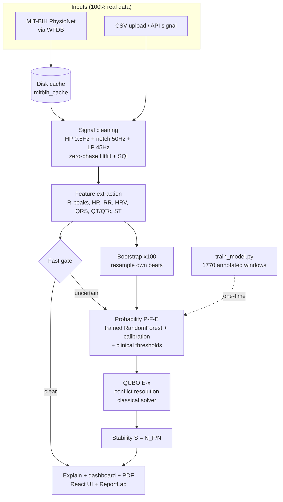

# Probabilistic Randomized QUBO-Based ECG Analyzer — Web Portal

Research prototype. Physician assistance only. All results from real data + trained model.

## Quick start (Windows)
```powershell
py -m pip install -r backend\requirements.txt
py -m backend.prefetch        # one-time: cache MIT-BIH records to disk (needs internet)
py -m backend.train_model     # one-time: train calibrated model on MIT-BIH annotations (~5 min)
py -m uvicorn backend.main:app --host 127.0.0.1 --port 8000
# open http://127.0.0.1:8000
```
100% real data: local MIT-BIH cache + trained model. No synthetic fallback exists -
the API raises an explicit error if data or model files are missing.

## Architecture



## Endpoints
- `GET /` — React medical dashboard
- `GET /api/records` — MIT-BIH record list
- `GET /api/analyze_mitbih?record=100&seconds=10&n_states=100&seed=42`
- `POST /api/analyze_signal` `{signal:[...], fs:360}`
- `POST /api/upload_csv` — CSV single-column upload
- `GET /api/report_mitbih?record=100&ai=true&clinic_name=..&patient_id=..&patient_name=..&age=..&sex=..` — doctor-style PDF with Gemini AI insights
- `GET /api/ai_insights?record=100` — Gemini insights as JSON (key stays server-side)
- `GET /api/health`

## Gemini AI interpretation (optional)
```powershell
$env:GEMINI_API_KEY="your-key-here"   # PowerShell (per session)
py -m uvicorn backend.main:app --host 127.0.0.1 --port 8000
```
Get a key at https://aistudio.google.com/apikey (see `.env.example`). Without a key, reports generate normally with "AI interpretation unavailable" marked. The key is never sent to the frontend or written into PDFs.

No key / quota trouble? Two key-free alternatives via `AI_PROVIDER` env:
- `template` — built-in deterministic writer, always works (honestly labeled, no LLM).
- `ollama` — local AI: install https://ollama.com, run `ollama pull llama3.1`, set `AI_PROVIDER=ollama`.

## Pipeline
Butterworth HP 0.5Hz + 50Hz notch Q30 + LP 45Hz (filtfilt) → features → P(F|E) trained/calibrated → bootstrap N=100 → QUBO classical → stability S=N_F/N → PDF.

## Hosting
- Docker: `docker compose up --build` → port 8000.
- Any PaaS: set start command `uvicorn backend.main:app --host 0.0.0.0 --port $PORT`.

## Docs
- `docs/TECHNICAL_DOCUMENTATION.md` — patent-research doc
- `docs/FILTER_VALIDATION.md` — filter settings validation
"# probabilistic-qubo-ecg-analyzer" 
